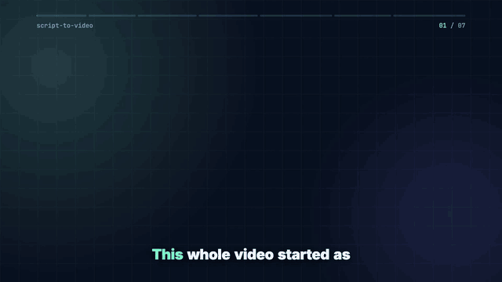

# script-to-video

Write a Markdown file, run one command, get a narrated video with word-by-word captions. Vertical 9:16, wide 16:9, or both.



The demo video above was made from [`examples/how-it-works.md`](examples/how-it-works.md): 7 scenes, 47 seconds, one command. Watch it with sound: [vertical](https://youtu.be/heDcIIi9GwU) · [wide](https://youtu.be/G7F9jcKQpyU).

Everything runs on your own machine. No accounts, no API keys, no per-video cost.

| Step | Tool |
|---|---|
| Voice | [Kokoro](https://github.com/thewh1teagle/kokoro-onnx), 82M-parameter TTS, runs on CPU |
| Word timing | [faster-whisper](https://github.com/SYSTRAN/faster-whisper) listens back to the voice |
| Picture | [Remotion](https://www.remotion.dev) (React), one component for both formats |
| Sound | ffmpeg: optional music under the voice, loudness set to −14 LUFS for YouTube |

## Quick start

You need Python 3.10+, Node.js 18+ and ffmpeg.

```bash
git clone https://github.com/jillzaymvp0147-ui/script-to-video
cd script-to-video
npm install
python3 -m venv .venv && .venv/bin/pip install -r requirements.txt

.venv/bin/python make.py examples/how-it-works.md
```

The first run downloads the voice model (about 330 MB) and the Whisper model (about 500 MB). The videos land in `out/`.

To change how scenes look without re-rendering every time, open the live preview:

```bash
.venv/bin/python make.py examples/how-it-works.md --studio
```

## Writing a script

```markdown
---
title: My channel
voice: am_michael
format: vertical
---

## hook
> number: 47 of 53 | crows remembered the mask
Forty-seven of fifty-three crows screamed at a mask they had seen once.

## why
> image: assets/crow.jpg
> headline: They *never* forget
...
```

- Settings go between the `---` lines at the top.
- Every `## name` starts a scene.
- A line starting with `>` sets the scene's picture.
- Every other line is what the voice says.

The captions show the script's own words, so names and numbers are spelled the way you wrote them. Whisper only supplies the timing.

### Pictures

| Line | What you see |
|---|---|
| `> headline: Every *word* on time` | Big text, words pop in one by one, `*word*` in the accent colour |
| `> number: $0 \| API cost per video` | A counter from 0 to the value; `100 → 0` counts down. Text after `\|` is the label |
| `> list: Voice \| Timing \| Render` | A checklist, items tick in across the scene |
| `> code: npm install \| ✓ done` | A terminal: the first line is typed, the rest appear as output |
| `> quote: Text — Author` | A quote card |
| `> image: assets/photo.jpg` | Your image with a slow zoom |
| `> video: assets/clip.mp4` | Your clip, muted |

An image or clip can sit under any of the first five, for example `> video:` plus `> headline:`. A scene with no `>` line shows its name as a headline. Paths are relative to the script file.

### Settings

| Key | Default | |
|---|---|---|
| `voice` | `am_michael` | Any [Kokoro voice](https://huggingface.co/hexgrad/Kokoro-82M/blob/main/VOICES.md): `af_heart`, `bm_lewis`, `bf_emma`… |
| `speed` | `1.0` | Speaking rate |
| `language` | `en-us` | `en-gb`; also `fr-fr`, `es`, `it`, `pt-br`, `hi` with a matching voice. English sounds best |
| `format` | `vertical` | `vertical`, `landscape` or `both` |
| `accent` | `#7cf5c8` | Highlight colour |
| `background` | `#0b1020` | Base colour |
| `music` | none | Path to an MP3 or WAV; it loops under the voice |
| `music_volume` | `-20` | Music level in dB |
| `pause` | `0.35` | Seconds of silence after each scene |
| `title` | none | Small label next to the scene counter |

## How it works

1. `stv/script.py` reads the Markdown into scenes.
2. `stv/voice.py` reads each scene aloud with Kokoro and records where each scene starts.
3. `stv/align.py` runs Whisper on each scene, matches what it heard against the script, and gives every word a start and end time. Words Whisper wrote differently, such as numbers and names, are fitted between their neighbours.
4. `make.py` writes `public/build/<name>/props.json` and calls `remotion render`.
5. `stv/master.py` mixes in the music, sets loudness to −14 LUFS and encodes H.264 that every player accepts.

The voice and timing are cached. If you only change the `>` lines, the next run goes straight to rendering.

The look lives in two files. `src/Video.tsx` holds the layout, progress bar and captions. `src/Visuals.tsx` holds the scene pictures. To add a new kind of picture, add a component there and its name to `VISUALS` in `stv/script.py`.

Render flags go through to Remotion, for example `--remotion-args="--concurrency=2"`.

## Licenses

The code in this repository is MIT. The tools it uses have their own terms:

- **Remotion is not MIT.** It is free for individuals and for companies of up to 3 people. Larger companies need a [company license](https://www.remotion.dev/license).
- Kokoro model and voices: Apache 2.0.
- faster-whisper: MIT; Whisper models: MIT.
- Fonts (Inter, JetBrains Mono): SIL Open Font License.

Use music, images and clips that you have the rights to.

## Custom work

I build video pipelines like this one and make videos with them: explainers, faceless YouTube videos, Shorts. You can reach me on [Upwork](https://www.upwork.com/freelancers/~018934fe9453e478f2).
